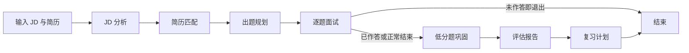

<div align="center">
  
  <h1>InterviewAgent</h1>
  <p><strong>从岗位要求到复习计划，一次完整的 AI 模拟面试</strong></p>
  <p>输入 JD 与简历 · 定向出题 · 实时追问与评分 · 生成评估和复习建议</p>
  <p>
    
    
    
    
  </p>
</div>

---

## 项目简介

InterviewAgent 是一个前后端一体的模拟面试项目。系统先分析岗位 JD 和候选人简历，再结合历史薄弱点与可选的个人题库规划题目；面试中逐题提问、评分和追问，结束后给出评估报告与复习计划。

**模型接入默认使用阿里云百炼 DashScope API Key**：对话模型默认为 `qwen-plus`，向量模型默认为 `text-embedding-v3`。API Key 从环境变量或后端目录的 `.env` 读取，不写入源码。

| 能力 | 实现方式 |
| --- | --- |
| 定向出题 | JD 分析、简历匹配、历史薄弱点与出题方向规划 |
| 个人题库 | 文档解析后写入向量索引与 BM25；Milvus 和 BM25 双路召回、RRF 融合与重排 |
| 互动面试 | WebSocket 推送阶段、题目和评分；回答队列支持逐题等待与主动退出 |
| 自适应提问 | 基础、经历、设计三个阶段；根据得分调整阶段内题目难度 |
| 结果沉淀 | 低分题巩固、评估报告、复习计划及历史会话 |

## 面试流程



后端使用 Spring AI Alibaba `StateGraph` 编排阶段；逐题问答、追问和难度调节在面试节点内部执行。前端通过 WebSocket 接收进度和结果，并提交用户回答。

## 技术栈

| 层 | 技术 |
| --- | --- |
| 前端 | React 19、TypeScript、Vite、Tailwind CSS、Zustand |
| 后端 | Java 21、Spring Boot 3.4、Spring WebSocket、Spring Security、JPA |
| AI | Spring AI Alibaba、DashScope、StateGraph |
| 检索 | Milvus、BM25、RRF、重排 |
| 存储 | MySQL、Redis；轻量开发模式可使用 H2 和本地索引 |

## 快速开始

### 1. 准备环境

安装 **JDK 21、Maven 3.9+、Node.js 20.19+ 或 22.12+**。完整基础设施模式还需要 Docker Compose。

### 2. 配置 API Key

在 `interview-agent-java` 目录复制模板，并只在本地填写自己的 Key：

```powershell
cd interview-agent-java
Copy-Item .env.example .env
```

```dotenv
DASHSCOPE_API_KEY=你的 DashScope API Key
LLM_MODEL=qwen-plus
EMBEDDING_MODEL=text-embedding-v3
```

`spring-dotenv` 会在后端启动时读取 `.env`。也可以直接设置同名环境变量。`.env` 已从 Git 跟踪中移除并加入忽略规则；**不要把真实 Key 提交到仓库或写进 IDE 运行配置**。

### 3. 启动后端

**轻量开发模式**：使用 H2、本地题库索引和进程内缓存，无需 Docker；模型仍通过 DashScope API Key 调用。

```powershell
mvn spring-boot:run "-Dspring-boot.run.profiles=local"
```

**完整基础设施模式**：使用 Docker Compose 启动 Milvus、Redis、MySQL，然后启动后端。

```powershell
docker compose up -d
mvn spring-boot:run
```

后端默认监听 `http://localhost:9090`。在 IntelliJ IDEA 中运行时，选择 `local` profile 即可使用轻量存储；不要同时启用 `ollama` profile。

### 4. 启动前端

打开另一个终端，在仓库根目录执行：

```powershell
cd interview-agent-web
npm install
npm run dev
```

访问 `http://localhost:5173`，注册或登录后即可开始面试。Vite 会把 `/api` 和 `/ws` 转发到后端。

## 目录结构

```text
interview-agent/
├── interview-agent-java/     # Spring Boot 后端、Agent、Graph、RAG 与数据访问
│   ├── src/main/resources/    # 默认 DashScope 配置与开发 profile
│   ├── data/questions/        # 示例题库
│   └── docker-compose.yml     # Milvus、Redis、MySQL
├── interview-agent-web/      # React 前端
└── start-local.ps1            # Windows 轻量模式启动脚本
```

更详细的后端实现见 [后端文档](interview-agent-java/README.md)，前端结构见 [前端文档](interview-agent-web/README.md)。

## 安全说明

JD、简历和面试文本会发送给所配置的模型服务。完整基础设施模式的 Compose 密码仅用于本地开发；公开部署前请更换数据库密码、JWT 密钥并配置访问控制。
